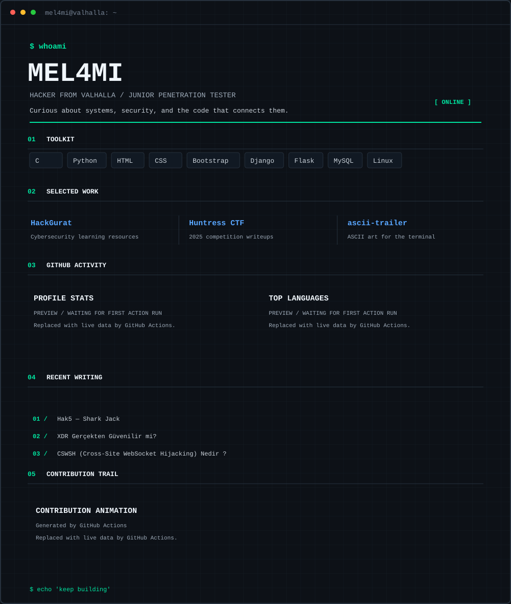

<!-- markdownlint-disable MD033 -->

  

  <a href="https://www.linkedin.com/in/muhammed-uzuner/">LinkedIn</a> &nbsp;·&nbsp;
  <a href="https://medium.com/@mel4mi">Medium</a> &nbsp;·&nbsp;
  <a href="https://tryhackme.com/p/mel4mi">TryHackMe</a> &nbsp;·&nbsp;
  <a href="https://www.buymeacoffee.com/mel4mi">Buy me a coffee</a>

